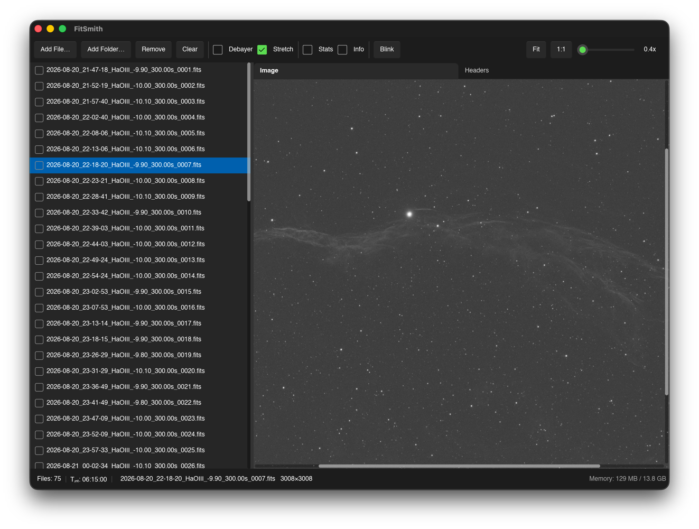
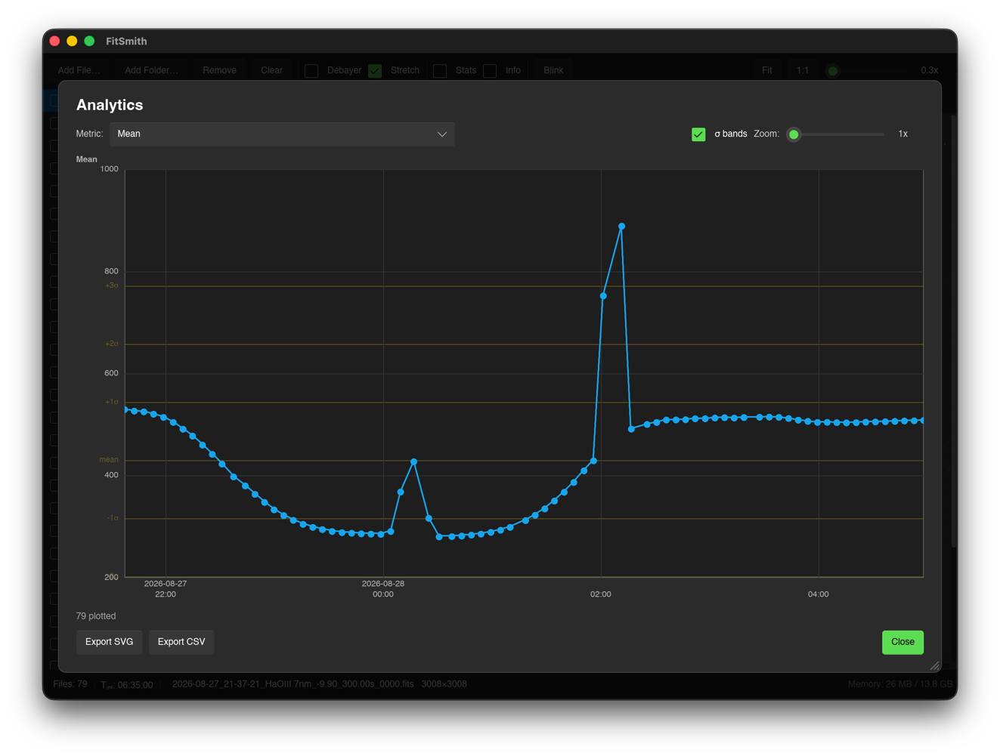

# FitSmith

FitSmith is a desktop viewer for FITS (astronomical image) files. Open a single file or whole folders of them, and FitSmith will debayer and stretch each image for display as needed.



## Features

 - View FITS and camera RAW images, with optional debayering and auto-stretch
 - Blink through the open files
 - Open a whole folder at once, optionally including its subfolders
 - The file list shows each file's frame type (light, dark, bias, flat or dark flat) as an icon, and marks compressed files
 - Select files quickly: select all, none, invert the selection, or select only the lights, darks, biases, flats or dark flats
 - Session summary (Tools ▸ Session Summary…): group the files into observing nights, frame types and filters, with frame counts and integration times. The summary can be copied to the clipboard as text
 - Export FITS files to JPEG, PNG or TIFF in batch
 - Compress or decompress FITS files in batch
 - Crop many files with the same rectangle (Tools ▸ Crop, Cmd/Ctrl+X), keeping every FITS header:
   - draw the rectangle on the preview
   - pick a fixed aspect ratio or crop free-form
   - crops the checked files, or all files if none are checked
   - cropped copies are added to the file list; overwritten files are reloaded in place
   - FITS files are cropped losslessly, and `.fz` files stay compressed. 
   - Bayer mosaics are cut on even pixels so the colour pattern stays valid
   - camera RAW files are converted to FITS on cropping, and are never overwritten
   - a file too small to hold the rectangle is reported as an error instead of being cropped
 - RGB compositor (Tools ▸ RGB Compositor…): check 3 or 4 monochrome images and mix them into a colour preview; Save… writes the result at full size as a FITS (`.fits`, `.fit`) or TIFF (`.tiff`) file, matching the preview; the file type is chosen in the dropdown beside the button
   - the first three images feed the red, green and blue channels, each with 0–1 sliders for how much it contributes to each channel
   - an optional fourth image is blended in as luminance
   - drag an image onto another to swap them; the preview is shown at 1/4 size
 - View the FITS header
 - View image statistics: mean, median, standard deviation, MAD, contrast, etc.
 - Estimate the real bit depth of an image
 - View star metrics: HFR, FWHM and eccentricity
 - Aberration inspector
 - Detect bad frames: find frames that stand out from the rest of the session because of noise, focus problems or tracking failures
 - Charts:
   - plot a statistic for all open files to see how, for example, star count or noise changed during the session
   - show the average and the ±1, 2 and 3σ bands to quickly spot outliers

For example, this chart of the mean pixel value clearly shows when wildfire smoke arrived and affected the seeing and sky brightness:


## Installing

Download the package for your system from the [GitHub releases](https://github.com/uaraven/fitz/releases) page: `.dmg` for macOS, `.deb` or `.rpm` for Linux, or a `.zip` with a portable `.exe` for Windows.

The packages are not signed, so your system will show a warning the first time you start FitSmith.

### macOS

Open the DMG and copy FitSmith to the Applications folder.

macOS will block the application the first time, because it is not notarized. Allow it in System Settings ▸ Privacy & Security, or run:

```shell
sudo xattr -rd com.apple.quarantine /Applications/FitSmith.app
```

### Linux

Install the package with your distribution's package manager:

```shell
sudo apt install ./fitsmith-<version>.deb

sudo dnf install ./fitsmith-<version>.rpm
```

### Windows

Download and unzip the archive, then run `fitsmith.exe`.

### Building from source

See [Building FitSmith](building.md) if you want to build FitSmith yourself.

## License

FitSmith is built with [Slint](https://slint.dev/) and is distributed under the GNU General Public License, version 3 (GPLv3).
