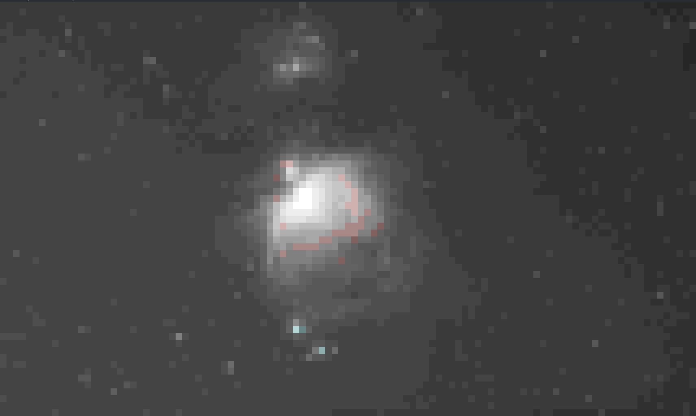
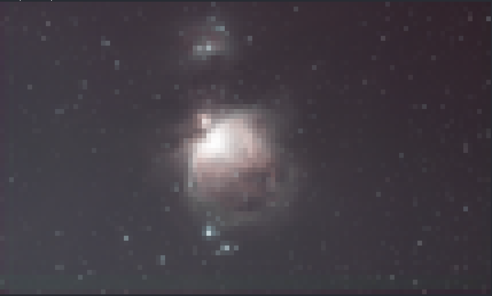
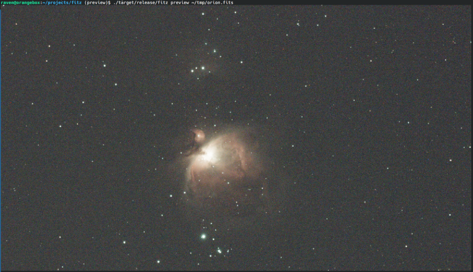

# fitz

Fitz is a command-line tool for working with FITS (astronomical image) files.

With fitz you can:
 - compress FITS files (RICE_1, GZIP_1 and GZIP_2) and decompress them again
 - debayer a colour (mosaic) image and save it as FITS, TIFF, PNG or JPEG
 - auto-stretch an image and save it as FITS, TIFF, PNG or JPEG
 - split an image into separate red, green and blue FITS files
 - show image information, pixel statistics and star metrics (HFR, FWHM, eccentricity)
 - preview an image right in the terminal
 - copy FITS header keywords from one file onto another
 - summarise a folder of images by observing night, frame type and filter

Debayering, stretching, splitting, preview and info also work on RAW files from popular digital cameras.

_Note_ that cameras with Sigma Foveon sensors are not supported.

## Usage

```shell
fitz [options] COMMAND [command-options]
```

Global options:
 - `-v`, `--verbose` - print each file being processed
 - `-j`, `--jobs` - number of files to process in parallel (default: number of CPU cores)
 - `-V`, `--version` - print the version and exit
 - `-h`, `--help` - print help

Most commands accept several files at once and process them in parallel. If one file fails, the error is reported and the remaining files are still processed. Use `-j 1` to process files one at a time.

Commands:
 - [`compress`](#compress) - compress FITS files
 - [`decompress`](#decompress) - decompress compressed FITS files
 - [`debayer`](#debayer) - debayer a colour mosaic image
 - [`stretch`](#stretch) - auto-stretch an image
 - [`split`](#split) - save each colour channel as a separate FITS file
 - [`info`](#info) - print a summary of an image, with optional pixel statistics and star metrics
 - [`preview`](#preview) - show an image in the terminal
 - [`copy-header`](#copy-header) - copy missing header keywords from one file onto another
 - [`summary`](#summary) - report the images in a folder by session, frame type and filter

Run `fitz COMMAND --help` to see all options of a command.

Every command reads compressed FITS files directly — there is no need to decompress them first. The Bayer pattern of a colour image is always taken from the file's `BAYERPAT` header.

### compress

Compresses FITS files. By default the compressed file replaces the original; use `-k` to keep the original.

```
Usage: fitz compress [OPTIONS] [FILES]...

Arguments:
  [FILES]...  FITS files to compress

Options:
  -k, --keep                   Keep original file after compression
  -y, --yes                    Assume yes to overwrite question
  -a, --algorithm <ALGORITHM>  Compression algorithm [default: rice1] [possible values: rice1, gzip1, gzip2]
  -o, --output <OUTPUT>        Write output to this file (only valid with a single input file)
```

### decompress

Decompresses compressed FITS files. By default the decompressed file replaces the original; use `-k` to keep the original. All header information is preserved.

```
Usage: fitz decompress [OPTIONS] [FILES]...

Arguments:
  [FILES]...  FITS files to decompress

Options:
  -k, --keep             Keep original file after decompression
  -y, --yes              Assume yes to overwrite question
  -o, --output <OUTPUT>  Write output to this file (only valid with a single input file)
```

### debayer

Debayers a colour mosaic image and saves it as a colour FITS, TIFF, PNG or JPEG file. Images that are already in colour, or monochrome images, are rejected with an error.

Unless `-o` is given, the result is saved next to the input as `{name}_debayer.{ext}`.

```
Usage: fitz debayer [OPTIONS] [FILES]...

Arguments:
  [FILES]...  FITS files to debayer

Options:
  -y, --yes                     Assume yes to overwrite question
      --bpp <BPP>               Bits per pixel in the output image: 8, 16 or 32 (FITS and TIFF only) [default: 16]
      --compress                Compress the output image (FITS only)
      --quality <QUALITY>       JPEG quality 0..100 [default: 90]
  -f, --output-format <FORMAT>  Output file format [default: fits] [possible values: fits, tiff, jpeg, png]
  -o, --output <OUTPUT>         Write output to this file, or to this folder if processing multiple files
```

PNG output is always 16-bit and JPEG output is always 8-bit.

### stretch

Applies an automatic stretch to an image, making faint detail visible, and saves the result as a FITS, TIFF, PNG or JPEG file.

`stretch` does **not** debayer: a colour mosaic stays a mosaic, a colour image stays colour and a monochrome image stays monochrome. Run `debayer` first if you want a stretched colour image from raw sensor data.

By default each colour channel is stretched separately, which also removes the background colour cast. Use `--linked-channel` to stretch all channels together and keep the original colour balance.

If the result is too dark, increase `--brightness`; to make it darker, decrease it.

FITS output is 32-bit floating point, TIFF and PNG are 16-bit, JPEG is 8-bit.

Unless `-o` is given, the result is saved next to the input as `{name}_stretch.{ext}`.

```
Usage: fitz stretch [OPTIONS] [FILES]...

Arguments:
  [FILES]...  FITS files to stretch

Options:
  -y, --yes                      Assume yes to overwrite question
      --linked-channel           Apply one shared stretch to all channels instead of stretching each channel independently
      --brightness <BRIGHTNESS>  Target background brightness, between 0 and 1; higher values produce a brighter image [default: 0.25]
  -f, --output-format <FORMAT>   Output file format [default: fits] [possible values: fits, tiff, jpeg, png]
  -o, --output <OUTPUT>          Write output to this file, or to this folder if processing multiple files
```

### split

Saves the red, green and blue channels of an image as three separate FITS files. A colour mosaic is debayered first; an image that is already in colour is split directly. Monochrome images cannot be split.

With `--cfa`, the channels are taken straight from the raw mosaic without debayering. Each output is then half the width and height of the original.

By default all three channels are saved next to the input file as `R-{name}`, `G-{name}` and `B-{name}`. If you give any of the prefix or directory options, only the channels you configured are saved. For each channel use either a prefix or a directory, not both. When saving into a directory the original file name is kept, so use a different directory for each channel. Directories are created if they don't exist.

```
Usage: fitz split [OPTIONS] [FILES]...

Arguments:
  [FILES]...  FITS files to split into channels

Options:
  -y, --yes                           Assume yes to overwrite question
  -p, --output-pixel-format <FORMAT>  Pixel format of the resulting FITS files [default: i16] [possible values: i8, i16, i32, f32, f64]
      --cfa                           Extract R, G and B straight from a raw mosaic instead of debayering first
      --r-prefix <R_PREFIX>           Prefix for the red channel file: {prefix}-{original-file-name}
      --r-dir <R_DIR>                 Directory to save the red channel file into (original filename kept)
      --g-prefix <G_PREFIX>           Prefix for the green channel file: {prefix}-{original-file-name}
      --g-dir <G_DIR>                 Directory to save the green channel file into (original filename kept)
      --b-prefix <B_PREFIX>           Prefix for the blue channel file: {prefix}-{original-file-name}
      --b-dir <B_DIR>                 Directory to save the blue channel file into (original filename kept)
```

### info

Prints a summary of each image without changing anything: resolution, bit depth, channels, Bayer pattern, object, RA/DEC, rotation, exposure, gain/offset, binning, filter, camera, telescope (with focal length and focal ratio) and observation date. Fields missing from the file are not shown.

`--pixels` adds a table of statistics for each colour channel, followed by a histogram:

 - **Min / Max / Mean / Median**
 - **Mode** — the most common pixel value, usually the sky background level
 - **Avg Dev** — the average deviation from the mean
 - **MAD** — the median absolute deviation, a noise estimate that ignores stars and hot pixels
 - **σ** — the standard deviation of all pixels. A σ much larger than MAD means the frame contains a lot of signal (or problems such as satellite trails)
 - **Bit-depth (est)** — the camera's actual bit depth (8, 10, 12, 14 or 16), estimated from the pixel values
 - **Zeros** — the number of pixels with a value of zero (clipped shadows)
 - **Saturated** — the number of pixels at full scale (blown highlights)

Use `--log` together with `--pixels` to draw the histogram with a logarithmic scale, which makes the shape of a histogram with a tall peak easier to see.

`--stars` detects the stars in the image and reports:

 - **count** — the number of stars found. Noticeably fewer stars than in neighbouring frames usually means clouds or haze
 - **hfr** — the half-flux radius. The main focus metric: smaller is sharper
 - **fwhm** — the full width at half maximum, which reflects focus and seeing
 - **eccentricity** — how elongated the stars are, from 0 (round) to nearly 1 (a streak). Rising eccentricity points to tracking or guiding problems. The scale is steep near zero: stars only 10% wider in one direction already read about 0.42, so a mid-range value means mild elongation, not a bad frame

Hot pixels, nebulosity, saturated stars and stars touching the edge of the frame are ignored. `--stars` and `--pixels` can be used separately or together.

`--headers` prints the raw FITS header instead of the summary.

```
Usage: fitz info [OPTIONS] [FILES]...

Arguments:
  [FILES]...  FITS files to inspect

Options:
      --pixels       Report pixel statistics and a histogram
      --stars        Detect stars and report their count, HFR, FWHM and eccentricity
      --log          Use a logarithmic vertical axis for the histogram (with --pixels)
      --headers      Print the raw FITS header cards instead of the formatted summary
```

### preview

Shows an image directly in the terminal — a quick way to look at a frame over SSH or without opening a viewer. The image is debayered if needed, auto-stretched and scaled to fit the terminal window. `--linked-channel` and `--brightness` work the same way as for [`stretch`](#stretch).

`preview` accepts exactly one file.

Your terminal needs to support at least 216 colours. Fitz picks the best mode the terminal supports:
 - **graphics mode** — the image is shown as a picture, in terminals that support the Kitty graphics protocol
 - **true-color mode** — in terminals with 24-bit colour
 - **fallback mode** — 216 colours; low quality, but enough for a quick look

Automatic detection works on Linux and macOS. On other systems, use `--graphics` if your terminal supports the Kitty graphics protocol.

|          Fallback mode           |       True-color mode       |         Graphics mode          |
| :------------------------------: | :-------------------------: | :----------------------------: |
|  |  |  |

`--no-debayer` shows a raw colour mosaic as a grayscale image instead of debayering it.

```
Usage: fitz preview [OPTIONS] <FILE>

Arguments:
  <FILE>  FITS file to preview

Options:
      --linked-channel           Apply one shared stretch to all channels instead of stretching each channel independently
      --brightness <BRIGHTNESS>  Target background brightness, between 0 and 1; higher values produce a brighter image [default: 0.25]
      --graphics                 Force graphics mode (Kitty graphics protocol)
      --truecolor                Force true-color mode
      --fallback                 Force 216-colour fallback mode
      --no-debayer               Show a raw mosaic as a grayscale image instead of debayering it
      --invert                   Invert the image
```

`--graphics`, `--truecolor` and `--fallback` cannot be combined.

### copy-header

Copies FITS header keywords from `SOURCE` onto `TARGET`, adding only the keywords `TARGET` doesn't already have — for example the object name, coordinates, filter or gain. Nothing already in `TARGET` is changed. If `TARGET` is already a colour (debayered) image, the Bayer pattern is not copied.

`TARGET` is modified in place unless `-o` is given.

```
Usage: fitz copy-header [OPTIONS] <SOURCE> <TARGET>

Arguments:
  <SOURCE>  FITS file to copy header keywords from
  <TARGET>  FITS file to copy header keywords into (modified in place unless --output is given)

Options:
  -y, --yes              Assume yes to overwrite question
  -o, --output <OUTPUT>  Write the result to this file instead of overwriting the target in place
```

### summary

Scans one or more folders, including all subfolders, and reports the FITS and camera RAW images in them, grouped by observing session, frame type and filter, with the number of frames and the total exposure time of each group.

 - **Session** — one observing night. Frames taken after midnight belong to the same night as the evening before. Frames without a date are listed under `unknown date`.
 - **Frame type** — light, dark, bias, flat or dark flat. It is taken from the `IMAGETYP` header. If the header doesn't have it, fitz looks at the names of the folders the image is in: a folder called `Lights`, `Darks`, `Biases`, `Flats` or `Dark Flats` (singular or plural, any capitalisation) sets the type. Otherwise the image is counted as a light frame.
 - **Filter** — taken from the `FILTER` header. Frames without a filter, including all camera RAW files, are listed as `(no filter)`.

Each session shows its light-frame integration time, a count of frames of every type, and the light frames broken down by filter. Calibration frames are counted but not broken down. The last line totals the light frames over all sessions.

`.tif` files are skipped. Files that cannot be read are reported as errors and left out of the summary.

_Note_ that if a FITS file has no local time or site longitude in its header, a night far from UTC may be split into two sessions. NINA and most capture software write the local time, so this rarely happens.

```
Session 2026-10-08 - 5h 49m 00s light integration
    86 light frames, 20 dark frames, 30 flat frames
  Lights  86 frames  5h 49m 00s
    R      9 frames  0h 18m 00s
    G      9 frames  0h 18m 00s
    B      9 frames  0h 18m 00s
    Ha    18 frames  1h 30m 00s
    SII   22 frames  1h 50m 00s
    OIII  19 frames  1h 35m 00s
Session 2026-10-09 - 7h 40m 00s light integration
    92 light frames
  Lights  92 frames  7h 40m 00s
    Ha    32 frames  2h 40m 00s
    SII   32 frames  2h 40m 00s
    OIII  28 frames  2h 20m 00s
Total: 2 sessions, 178 light frames, total integration 13h 29m 00s
```

```
Usage: fitz summary [OPTIONS] <DIRS>...

Arguments:
  <DIRS>...  Directories to scan recursively for FITS and camera RAW images
```
